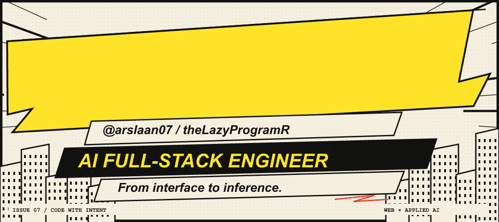
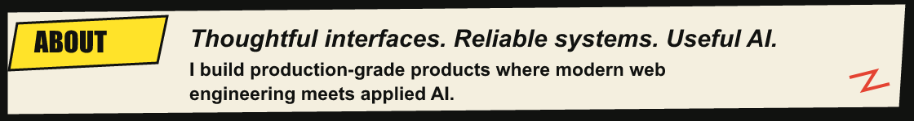
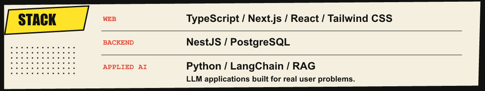
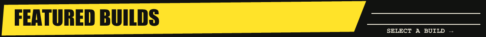
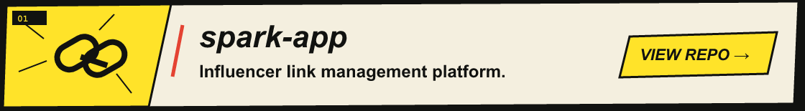
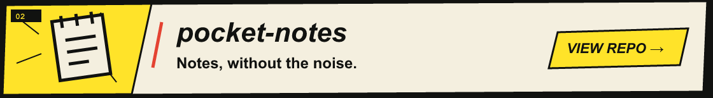
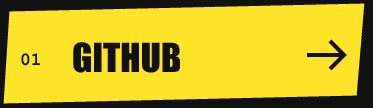
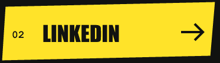
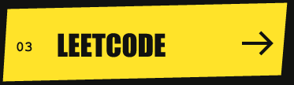
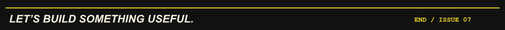

<!-- Artwork is generated by scripts/build-profile.mjs. See docs/profile-design.md. -->

  
   
  <a href="./assets/rebel/hero.png">View the still version</a>

  
   
  
   
  
   
  
   
  

  
  
  
   
  

Profile, stack & project links in plain text

### Arslaan · theLazyProgramR

**AI Full-Stack Engineer** — From interface to inference.

I build production-grade products where modern web engineering meets applied AI. Thoughtful interfaces. Reliable systems. Useful AI.

- **Web:** TypeScript, Next.js, React, Tailwind CSS
- **Backend:** NestJS, PostgreSQL
- **Applied AI:** Python, LangChain, RAG, LLM applications

**Featured builds**

- [spark-app](https://github.com/arslaan07/spark-app) — an influencer link management platform.
- [pocket-notes](https://github.com/arslaan07/pocket-notes) — notes, without the noise.

**Connect:** [GitHub](https://github.com/arslaan07) · [LinkedIn](https://www.linkedin.com/in/arslaan-shakeel-aa5885209/) · [LeetCode](https://leetcode.com/arslaanbanday5/)

[Motion-free title artwork](./assets/rebel/hero.png)

<!-- sudo collaborate --with arslaan07 -->
